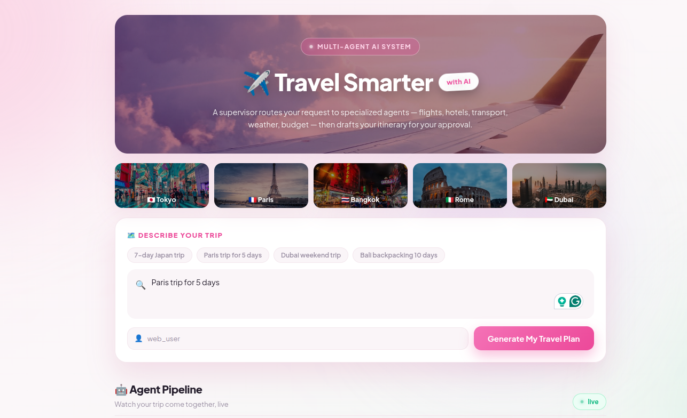

# AI Travel Planner

A multi-agent travel planner built with **LangGraph**. A supervisor agent reads your request, picks the specialist agents that are needed (flights, hotels, transport, weather, budget), and builds a day-by-day itinerary. A human approves it before the final plan is produced.



## Features

- **Supervisor routing**: an LLM decides which agents run for each request. A guardrail rejects requests that aren't about travel.
- **Specialist agents**:
  - ✈️ **Flight**: airports and airlines from Aviationstack, plus route, fare and booking advice
  - 🏨 **Hotel**: web search for where to stay (Tavily)
  - 🚇 **Transport**: web search for local transport, transfers and passes (Tavily)
  - 🌤️ **Weather**: current weather and forecast from OpenWeather
  - 💰 **Budget**: cost breakdown, risks and ways to save
  - 🗓️ **Itinerary**: a draft plan that combines all of the above
- **Human-in-the-loop**: the graph pauses to ask for missing information (for example, your departure city) and to get approval of the draft. If you reject it, your feedback is used to revise the plan.
- **Persistent memory**: conversation state is saved in PostgreSQL through the LangGraph checkpointer, keyed by thread/user ID.
- **MCP tools**: Tavily (remote), plus local Aviationstack and Weather MCP servers.
- **Live UI**: a FastAPI backend streams each agent's output to the browser over Server-Sent Events, rendered as markdown.
- **LangSmith tracing**: every run is traced and grouped into LangSmith **Threads** by `thread_id`.

## Architecture

```
START → supervisor ─┬→ flight_agent ─┐
                    ├→ hotel_agent ──┤   (only the agents the supervisor
                    ├→ transport ────┤    picked, run in this order)
                    ├→ weather ──────┤
                    └→ budget ───────┘
                                     ↓
                          itinerary_agent → human_approval (interrupt) → final_response → END
```

| File | Purpose |
|------|---------|
| `app.py` | FastAPI app: UI, SSE endpoints `/api/plan`, `/api/answer`, `/api/approve`, LangSmith run config |
| `graph.py` | LangGraph `StateGraph`, routing, Postgres checkpointer |
| `agents.py` | Agent node implementations |
| `state.py` | `TravelState` definition |
| `mcp_client.py` | MCP client (Tavily, Aviationstack, Weather) |
| `aviationstack_mcp_server.py` / `weather_mcp_server.py` | Local MCP servers (stdio) |
| `config.py` | Env loading, LLM (Groq `openai/gpt-oss-20b`), database URL |
| `templates/`, `static/` | Frontend |

## Getting started

### 1. Environment variables

Create a `.env` file in the project root:

```env
# LLM
GROQ_API_KEY=

# Tools
TAVILY_API_KEY=
AVIATIONSTACK_API_KEY=
OPENWEATHER_API_KEY=

# Postgres (checkpointer)
POSTGRES_USER=postgres
POSTGRES_PASSWORD=postgres
POSTGRES_DB=travel_planner

# LangSmith tracing (optional)
LANGSMITH_TRACING=true
LANGSMITH_API_KEY=
LANGSMITH_ENDPOINT=https://api.smith.langchain.com
LANGSMITH_PROJECT=ai-travel-planner

# Verbose agent logs in the console (optional)
DEBUG_LOGS=0
```

### 2a. Run with Docker (recommended)

```bash
docker compose up -d --build
```

Open **http://localhost:8001**.

### 2b. Run locally

```bash
python -m venv .venv
source .venv/bin/activate
pip install -r requirements.txt

# Postgres must be running and reachable (POSTGRES_HOST defaults to localhost)
uvicorn app:app --reload --port 8000
```

Open **http://localhost:8000**. If `POSTGRES_DB` isn't set, the graph runs without persistence.

## Usage

1. Describe your trip, e.g. *"7 days in Japan from Morocco, mid budget, love food and culture"*.
2. Watch each selected agent's card fill in.
3. If information is missing (such as the departure city), answer the question in the UI.
4. Review the draft itinerary, then **Approve** it or **Reject** it with feedback.
5. The final plan appears at the bottom. Download it as markdown.

The **User ID** field is used as the LangGraph `thread_id`. Runs with the same ID share memory and appear as one thread in LangSmith.

## Observability

With `LANGSMITH_TRACING=true`, open your project in LangSmith and go to the **Threads** tab. Each conversation is listed there: the `travel_planner.plan`, `travel_planner.answer` and `travel_planner.approve` runs, with every LLM and tool call nested inside them.

Set `DEBUG_LOGS=1` to print raw LLM responses and tool data to the console.

## Tech stack

LangGraph · LangChain · Groq · MCP (`langchain-mcp-adapters`) · Tavily · Aviationstack · OpenWeather · FastAPI · PostgreSQL · LangSmith · Docker
